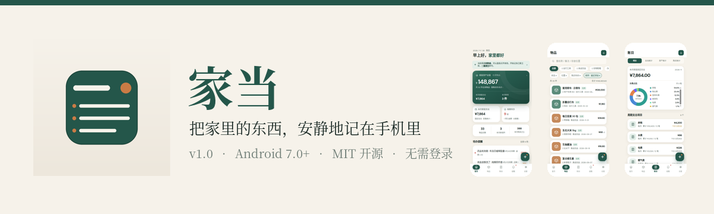
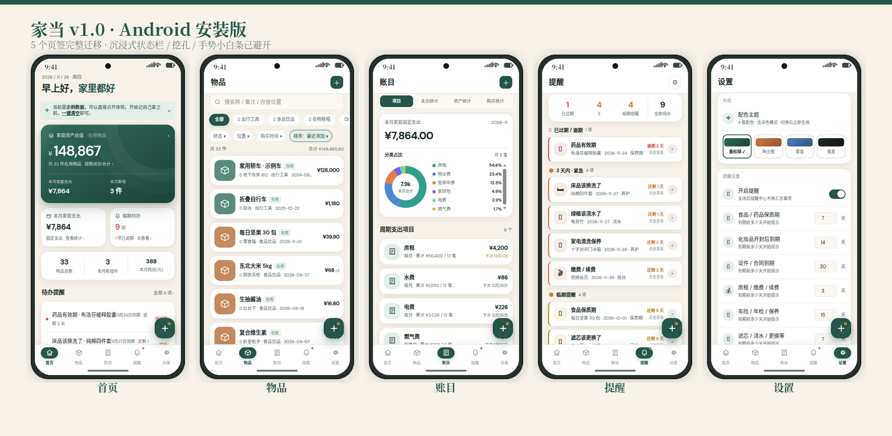
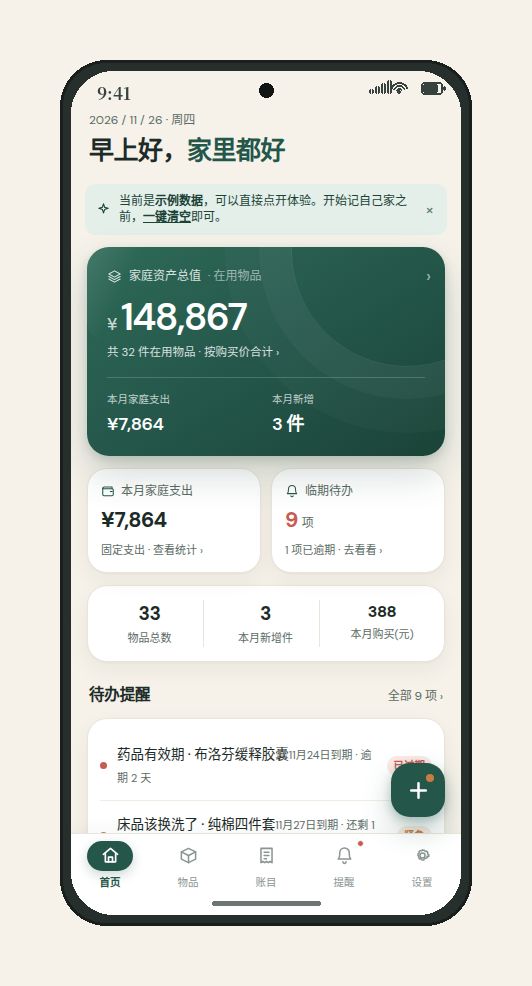
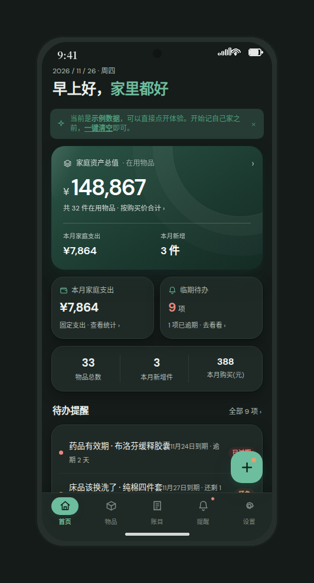
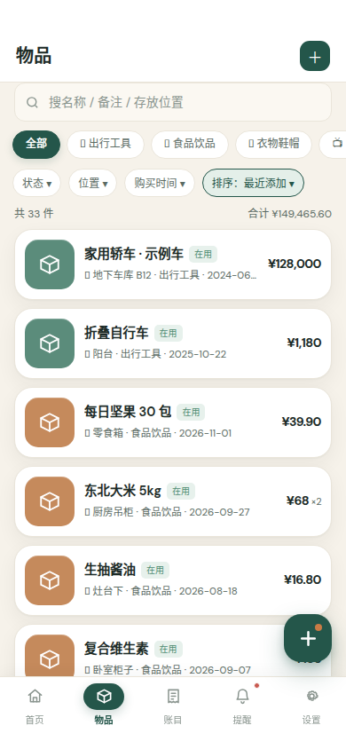
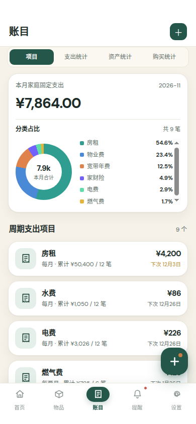
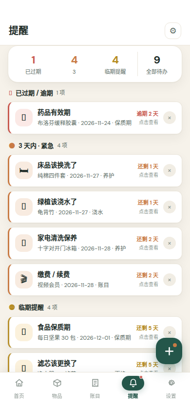
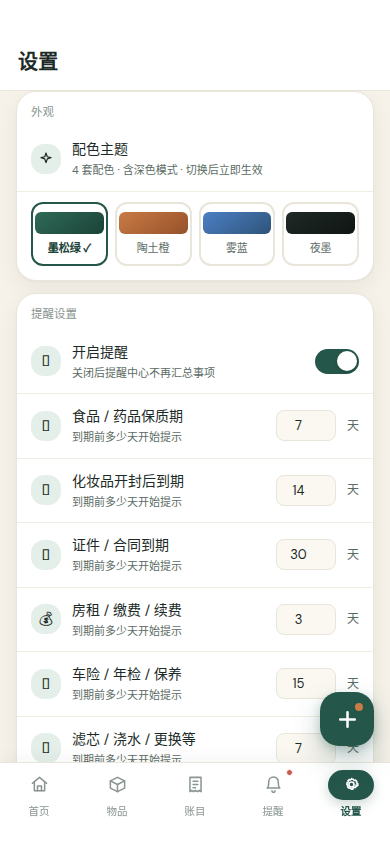

<p align="center">
  
</p>

<p align="center">
  <a href="README.md">简体中文</a> | <strong>English</strong>
</p>

<h1 align="center">Jiadang · Home Inventory &amp; Household Accounts</h1>

<p align="center">
  
  
  
  
  
</p>

<p align="center">
  Quietly keep track of your belongings, spending, and expiry dates right on your phone.<br>
  A <strong>fully offline</strong> Android app — <strong>no account needed, and your data never leaves the device</strong>.
</p>

| Item | Details |
|---|---|
| Version | **v1.0** (first public release, 2026-11-26) |
| Deliverable | A real Android installer `.apk` — not a web page, not an "Add to Home Screen" shortcut |
| Application ID | `cn.jiadang.app` |
| Requires | Android 7.0 (API 24) or later |
| APK size | About 207 KB |
| License | Original parts [MIT](LICENSE); fonts under SIL OFL 1.1, see [NOTICE.md](NOTICE.md) |
| Network &amp; privacy | Zero network requests, zero accounts, zero cloud, zero third-party SDKs |

---

## 👀 At a Glance

<p align="center">
  
</p>

<p align="center">
  
  
</p>

| App icon | Items | Bills |
|:---:|:---:|:---:|
|  |  |  |

| Reminders | Settings | Download QR |
|:---:|:---:|:---:|
|  |  |  |

---

## ✨ What It Can Do

### 5 tabs

| Tab | Contents |
|---|---|
| **Home** | Total household asset value, this month's spending, upcoming reminders, new items this month, quick shortcuts |
| **Items** | Checklists across 16 categories, category filters, search, details, photos, add/edit/delete, custom categories and fields |
| **Bills** | Recurring payment items, payment records, monthly spending, purchase statistics, asset statistics and charts |
| **Reminders** | Grouped by expiry (red / orange / yellow), dismiss and restore reminders |
| **Settings** | 4 themes, reminder toggles, category &amp; field management, import/export, install &amp; about |

### 16 categories, each with its own fields

Transportation, food &amp; drinks, clothing &amp; footwear, appliances &amp; electronics, furniture &amp; home goods, kitchenware, cleaning &amp; personal care, medicine &amp; health, daily consumables, documents &amp; certificates, books &amp; entertainment, sports &amp; outdoors, pet supplies, plants &amp; flowers, tools &amp; hardware, and miscellaneous.

Beyond the common fields (purchase date / price / quantity / location), every category has its own: food items have production date and shelf life, appliances have warranty and cleaning cycles, medicine has dosage and remaining quantity, documents have expiry dates, filter cartridges have installation date and replacement cycles, plants have watering and fertilizing schedules — all freely extensible.

### Vehicle maintenance &amp; fuel

Fuel records (fuel grade / unit price / amount / mileage), monthly fuel costs, fuel consumption per 100 km, maintenance records, insurance periods and premiums, inspection dates — all summarized automatically from your records.

### Expiry reminder engine

Instead of manually entering a reminder date, deadlines are computed automatically from rules:

- Production date + shelf life, opened date + shelf life after opening
- Filter replacement cycles, plant watering cycles, medicine expiry, document expiry, warranty expiry
- Vehicle maintenance / insurance / inspection, monthly due dates for payment items
- Graded red / orange / yellow by lead time, shown on both Home and Reminders

### Accounts &amp; statistics

Templated items for rent, utilities, property fees, broadband, phone bills, subscriptions, insurance, and more; monthly spending curves, total asset value, purchase statistics over any period, and historical item values.

### Your data, entirely yours

- Export: CSV, Excel (SpreadsheetML `.xls`), and full JSON backup
- Import: one-click restore from a JSON backup
- On-phone exports are written to the system "Downloads" folder through a native bridge
- All data stays in on-device `localStorage` — never uploaded, no login needed

---

## 📱 Built for Modern Phones

Status bar, centered punch-hole / notch, and the bottom gesture bar are all handled with proper insets:

```
WindowInsets / DisplayCutout (measured)
        ↓  dp values injected
CSS variables --sa-top / --sa-bottom / --sa-left / --sa-right
        ↓
Content and bottom tabs automatically stay within the safe area
```

System bars are set to transparent immersive mode, with icon brightness following the theme (light status-bar icons automatically under the `night` theme). The "9:41", punch-hole, and gesture bar in `01-home.png` and `02-overview.png` show the adapted result — no content is covered, and all 5 bottom tabs remain fully visible.

---

## 📲 Installation

| # | Method | How |
|---|---|---|
| ① | **GitHub Releases (recommended)** | Download `Jiadang-v1.0.apk` from the [Releases page](https://github.com/MossDock/jiadang/releases) and install |
| ② | Direct link / QR code (fallback) | Open the link below in your phone browser, or scan `screenshots/09-download-qr.png` |

**Fallback direct link** (temporary third-party hosting; the `?sharecode=...` is an access credential and must be kept intact):

```
https://af2571c507cfa1204.app.workbuddy.host/Jiadang-v1.0.apk?sharecode=S3K5X2JBYF
```

After downloading, tap the file → allow "Install unknown apps" when prompted → install. A standalone "家当" icon appears on your home screen; tap to use, no browser involved.

| Prompt on your phone | What to do |
|---|---|
| "There was a problem parsing the package" / App not installed | The file was renamed or incompletely downloaded; re-download via the direct link in your phone browser — the full size is **211896 bytes** |
| Install blocked (unknown sources) | Enable "Install unknown apps" for your browser in system settings |
| Can't find the file after download | Look for `Jiadang-v1.0.apk` in the "Downloads" folder |
| iPhone / iPad | This is an Android installer; not applicable to Apple devices |

---

## 🛠️ Technical Implementation

| Layer | Approach |
|---|---|
| Shell | A single `MainActivity` + `WebView`, pure AOSP APIs — **no AndroidX, no Gradle, no third-party dependencies** |
| Resource loading | Fixed virtual origin `https://jiadang.app/`; `shouldInterceptRequest()` maps to `assets/web/`, fully offline |
| Data | `localStorage` (key `jiadang-db-v1`); the fixed https origin keeps persistence stable |
| Native bridge | `window.JD`: `saveFile` exports to Downloads, `setTheme` syncs system bars, `onHash` / `onReady` for routing and safe areas; plus a file picker and layer-by-layer back handling |
| Build | `aapt2` → `javac` → `d8` → `zipalign` → `apksigner` (v2 / v3 signing), all via hand-written scripts |

All page assets, fonts, and icons are bundled into the APK; no network requests are made at runtime.

---

## 📂 Source Layout

```
jiadang/
├── README.md                 This document (Chinese)
├── README.en.md              English version of this document
├── LICENSE                   MIT license (original parts)
├── NOTICE.md                 Third-party assets and rights notices
├── licenses/                 Full OFL 1.1 license texts for the fonts
│   ├── DM-Sans-OFL.txt
│   └── NotoSerifSC-OFL.txt
├── src/                      All source code and file layout
│   ├── web/                  Web front end (all business logic)
│   │   ├── index.html  app.css  manifest.webmanifest  sw.js
│   │   ├── js/ 01-schema.js … 10-app.js
│   │   ├── native-bridge.js  APK-specific bridge layer
│   │   └── icons/  fonts/
│   └── android/              Android native shell and build scripts
│       ├── src/cn/jiadang/app/MainActivity.java
│       ├── AndroidManifest.xml  res/
│       └── icons.py  prepare.py  build.sh
└── screenshots/              All images (referenced by the README)
```

The installer `Jiadang-v1.0.apk` is not committed with the source; it is published on the repo's [Releases page](https://github.com/MossDock/jiadang/releases).

### Building locally

Prerequisites: JDK 8+, Android SDK (`platforms;android-34`, `build-tools;34.0.0`); you can point to the SDK with `ANDROID_HOME`.

```bash
cd src/android
python3 prepare.py     # Generates assets/web and res resources plus the full icon set from ../web
bash build.sh          # Compiles and signs, output to ../家当-v1.0.apk
```

`app.keystore` is generated automatically on first build and is **deliberately not committed** (private keys should never be public). The flow above has been tested in an isolated directory and can produce a signed APK independently of the original workspace.

---

<details>
<summary>📜 Origin &amp; Creation Statement (click to expand)</summary>

To avoid any misunderstanding, here is a complete account of how this software came to be:

1. **Requirements**: The feature scope came from the author's requirements document "家庭物品与账目台账-需求文档.md" — 5 bottom tabs, 16 item categories, bills, reminders, statistics, export, offline and on-device storage. That document was used only as a feature checklist; none of its layout or third-party material was copied.
2. **How it was created**: All code (native Android Java; native JavaScript / HTML / CSS for the web front end), UI layout, icons, sample data, and documentation were **written from scratch with AI assistance**, not derived from or adapted from any existing app's source code, decompiled output, or template project.
3. **What was NOT used**: No code, UI screenshots, icons, marketing copy, trademarks, logos, or app screenshots from any existing app; no third-party icon sets, UI component libraries, chart libraries, or icon fonts. The linear SVG icons in the UI are hand-written `path` data; the app icon is drawn with geometric primitives by `icons.py` (warm paper background + dark-green item card + three list lines + terracotta-orange accent — no text, no embedded fonts).
4. **Design references**: Visuals and interaction follow only the **general design principles** of Material 3 / Apple HIG (8pt grid, card corner radius, safe areas, restrained shadows); no code, components, or assets were copied. The color palette is a generic combination and no exclusive rights are claimed.
5. **Fonts**: DM Sans and Noto Serif SC come from Google Fonts and are used under SIL OFL 1.1; full license texts are in `licenses/`. The APK bundles only the unmodified DM Sans latin subset.
6. **Sample data**: Entirely fictional placeholders. Real trademarks such as Toyota, Haier, Uniqlo, Dyson, Omron, PICC, and Ping An have been removed, along with near-real license plates and contact details, replaced with generic text like "Sample Brand / Sample Car / Sample Plate / Sample Contact".
7. **Naming**: The launcher name 「家当」 was confirmed by the author; internal identifiers (application ID, virtual domain, storage key, cache name) were unified accordingly, with no legacy branding left.

</details>

---

## ⚖️ Copyright &amp; Trademark Notice

- The **original parts** are open-sourced under [MIT](LICENSE) — free to use, modify, and distribute, provided the copyright and license notices are retained.
- The only **third-party assets** are two OFL 1.1 fonts; see [NOTICE.md](NOTICE.md) and `licenses/` for the grants and compliance. The project contains no other third-party material or runtime dependencies.
- **Name &amp; trademark risk (please read)**: Public searches show existing store apps with similar names and overlapping purposes ("我的家当 – 个人物品清单", "家当家庭版", "HomeKeep 家当管家"). This software is **not affiliated** with them in any way and uses none of their material, nor does it claim any trademark rights. It is positioned as a **personal, non-commercial open-source work**, not intended for app-store distribution or commercial promotion.
- **Platform trademarks**: Android is a trademark of Google LLC, used here only descriptively to indicate the runtime environment; no logos or graphics are used, and the project is not affiliated with or endorsed by Google.
- **Disclaimer**: This project is provided "as is", without warranty. If you plan to publish it on an app store, use it commercially, or file for a trademark, complete an official trademark search first and consider renaming the app if necessary.

---

## 🏷️ Version

**v1.0 (2026-11-26)** — First public release: 5 tabs, 16 item categories, vehicle maintenance &amp; fuel tracking, expiry reminders, bills &amp; statistics, CSV/Excel/JSON import &amp; export, 4 themes, modern safe-area adaptation, fully offline on-device storage — plus complete brand unification, redrawn icons, and copyright-compliance cleanup.

---

## 📚 Related Documents

- [LICENSE](LICENSE) — MIT license
- [NOTICE.md](NOTICE.md) — Third-party assets and rights notices
