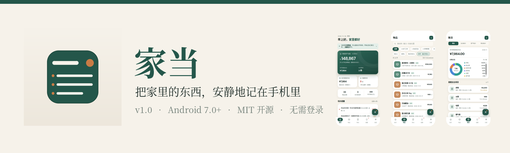
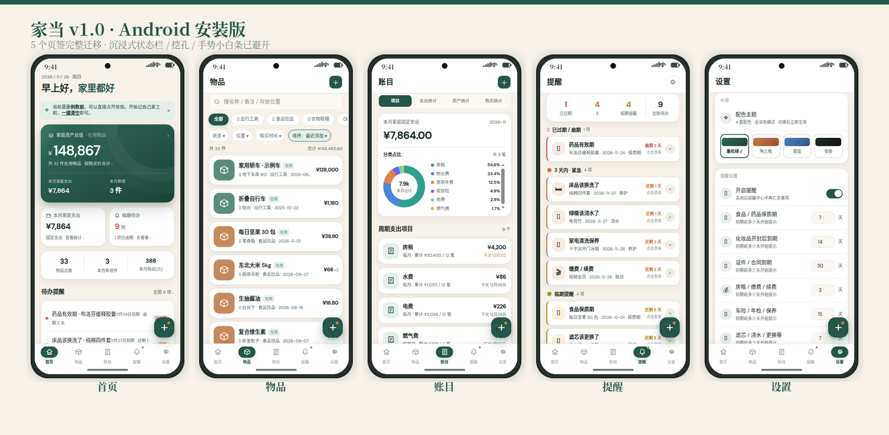
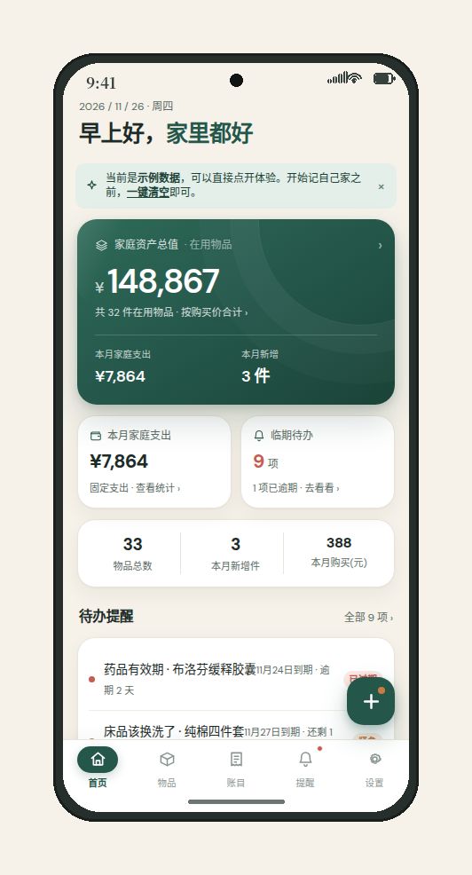
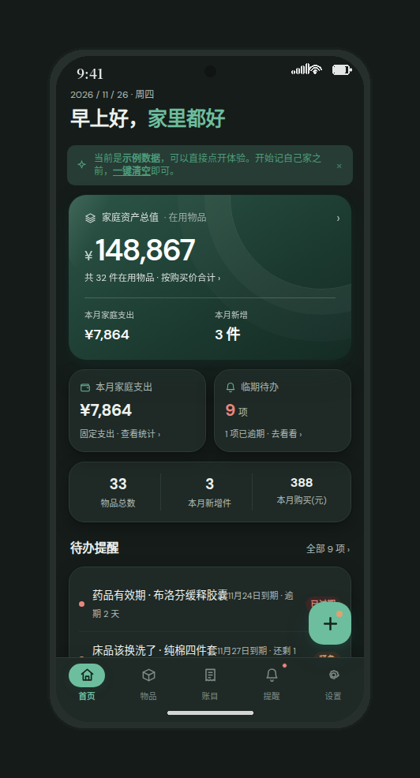
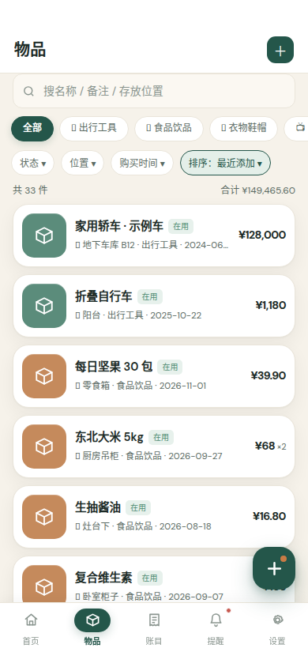
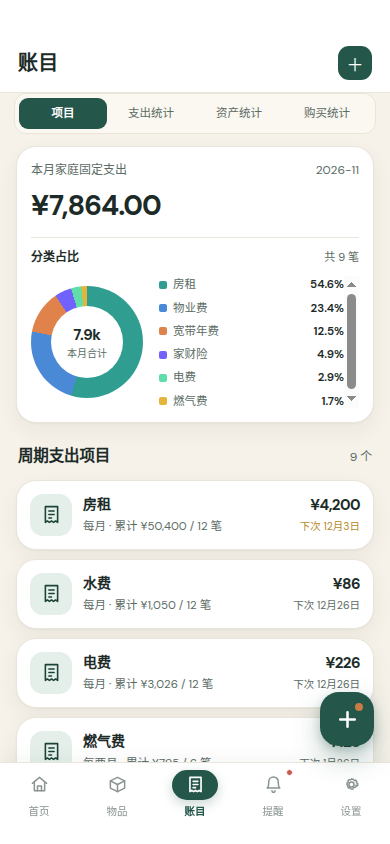
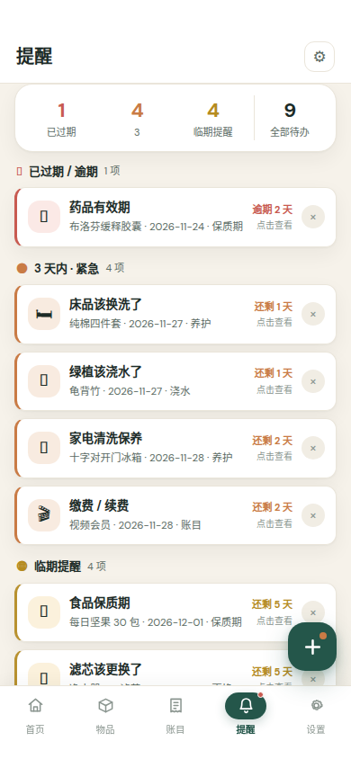
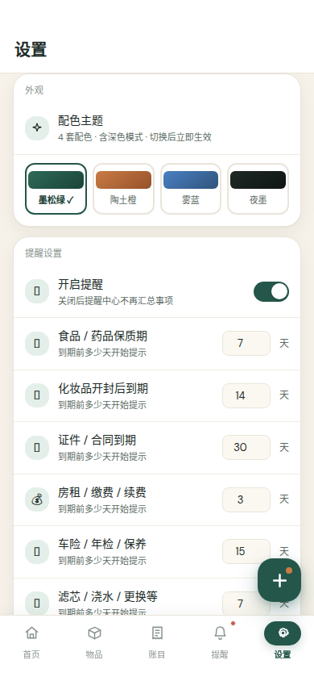

<p align="center">
  
</p>

<h1 align="center">家当 · 家庭物品与账目</h1>

> 把家里的东西、花费和到期日，安静地记在手机里。
> **完全离线 · 无需登录 · 数据只存本机** 的 Android 应用。

| 项目 | 内容 |
|---|---|
| 版本 | **v1.0**（首个公开版本，2026-11-26） |
| 交付形态 | 真正的 Android 安装包 `.apk`，不是网页，也不是「添加到主屏幕」 |
| 应用标识 | `cn.jiadang.app` |
| 系统要求 | Android 7.0（API 24）及以上 |
| 安装包体积 | 约 207 KB |
| 许可证 | 原创部分 [MIT](LICENSE)；字体适用 SIL OFL 1.1，见 [NOTICE.md](NOTICE.md) |
| 网络与隐私 | 零网络请求、零账号、零云端、零第三方 SDK |

---

## 一、一眼看懂



<p>
  
  
</p>

| 应用图标 | 物品页 | 账目页 |
|:---:|:---:|:---:|
|  |  |  |

| 提醒页 | 设置页 | 下载二维码 |
|:---:|:---:|:---:|
|  |  |  |

---

## 二、它能做什么

### 5 个页签

| 页签 | 主要内容 |
|---|---|
| **首页** | 家庭资产总值、本月支出、临期待办、本月新增、快捷入口 |
| **物品** | 16 大类物品清单、分类筛选、搜索、详情、照片、增删改、自定义类别与字段 |
| **账目** | 缴费项目、缴费记录、月度支出、购买统计、资产统计与图表 |
| **提醒** | 到期/临期分组（红 / 橙 / 黄）、关闭与恢复提醒 |
| **设置** | 4 套主题、提醒开关、类别与字段管理、导入导出、安装与关于 |

### 16 大类物品，各有专属字段

出行工具、食品饮品、衣物鞋帽、家电数码、家具家居、厨房用品、清洁洗护与个护美妆、
药品健康、日用消耗品、证件文件、图书文娱、运动户外、宠物用品、绿植花卉、工具五金、其他杂物。

每一类除「购买日期 / 价格 / 数量 / 位置」等公共字段外，还有自己的字段：
食品有生产日期与保质期，家电有保修与清洁周期，药品有用法与剩余量，
证件有到期日，滤芯有安装日与更换周期，绿植有浇水与施肥周期……均可自定义扩展。

### 车辆养护与油耗

加油记录（油号 / 单价 / 金额 / 里程）、月度油费、百公里油耗、
保养记录、保险起止与保费、年检日期，全部按记录自动汇总。

### 到期提醒引擎

不是手填一个提醒日，而是按规则自动推算：

- 生产日期 + 保质期、开封日期 + 开封后保质期
- 滤芯更换周期、绿植浇水周期、药品有效期、证件到期、保修到期
- 车辆保养 / 保险 / 年检、缴费项目的每月应缴日
- 按提前天数分级为红 / 橙 / 黄，首页与提醒页同步显示

### 账目与统计

房租、水电燃气、物业、宽带、话费、会员、保险等模板化项目；
月度支出曲线、资产总值、按时间段的购买统计、历史物品价值。

### 数据完全归你

- 导出：CSV、Excel（SpreadsheetML `.xls`）、JSON 完整备份
- 导入：JSON 备份一键还原
- 手机端导出由原生桥接写入系统「下载」目录
- 全部数据保存在本机 `localStorage`，不上传、不需要登录

---

## 三、现代手机适配

状态栏、居中挖孔 / 刘海、底部手势小白条都做了避让：

```
WindowInsets / DisplayCutout 实测
        ↓  dp 值注入
CSS 变量 --sa-top / --sa-bottom / --sa-left / --sa-right
        ↓
页面内容与底部页签自动落在安全区内
```

系统栏设为透明沉浸式，图标深浅随主题同步（`night` 夜墨主题下自动切浅色状态栏图标）。
上面 `01-home.png` 与 `02-overview.png` 里的「9:41」、挖孔、小白条都是适配后的效果，
内容没有被遮挡，底部 5 个页签完整可见。

---

## 四、安装方式（多种）

| # | 方式 | 怎么用 |
|---|---|---|
| ① | **解压本压缩包（推荐）** | 解压 `家当-v1.0.zip`，点根目录的 `家当-v1.0.apk` 安装 |
| ② | 手机浏览器直链 / 扫码 | 在手机浏览器打开下方链接，或扫 `screenshots/09-download-qr.png` |
| ③ | 附件卡片 / 系统分享 / 剪贴板 | 通过文件卡片、设备分享面板保存，或复制直链到手机浏览器打开 |

**直链**（`?sharecode=...` 是访问凭据，必须整条保留）：

```
https://af2571c507cfa1204.app.workbuddy.host/Jiadang-v1.0.apk?sharecode=S3K5X2JBYF
```

下载完点开 → 系统提示时允许「安装未知来源应用」→ 安装。
桌面会出现独立的「家当」图标，点开即用，全程不经过浏览器。

| 手机上看到的提示 | 处理 |
|---|---|
| 解析包错误 / 应用未安装 | 文件被改名或没下完，用直链在手机浏览器重下，完整大小 **211896 字节** |
| 禁止安装未知来源应用 | 在系统设置里给所用浏览器开启「安装未知应用」权限 |
| 下载完找不到文件 | 到「下载」目录找 `Jiadang-v1.0.apk` |
| iPhone / iPad | 本包是 Android 安装包，苹果设备不适用 |

---

## 五、技术实现

| 层 | 做法 |
|---|---|
| 外壳 | 单个 `MainActivity` + `WebView`，纯 AOSP API，**无 AndroidX、无 Gradle、无第三方依赖** |
| 资源加载 | 固定虚拟 origin `https://jiadang.app/`，`shouldInterceptRequest()` 映射到 `assets/web/`，完全离线 |
| 数据 | `localStorage`（键 `jiadang-db-v1`），固定 https origin 保证持久化稳定 |
| 原生桥接 | `window.JD`：`saveFile` 导出到下载目录、`setTheme` 同步系统栏、`onHash` / `onReady` 路由与安全区；另有文件选择器与返回键逐层退出 |
| 构建 | `aapt2` → `javac` → `d8` → `zipalign` → `apksigner`（v2 / v3 签名），全部手工脚本 |

页面资源、字体、图标全部打进 APK，运行时不发起任何网络请求。

---

## 六、源码结构

```
家当-v1.0/
├── 家当-v1.0.apk             Android 安装包（可直接安装）
├── README.md                 本文档
├── LICENSE                   MIT 许可证（原创部分）
├── NOTICE.md                 第三方资产与权利声明
├── 版权合规分析.md            逐类版权自查报告
├── licenses/                 字体 OFL 1.1 许可证全文
│   ├── DM-Sans-OFL.txt
│   └── NotoSerifSC-OFL.txt
├── src/                      全部源码与文件架构
│   ├── web/                  Web 前端（全部业务逻辑）
│   │   ├── index.html  app.css  manifest.webmanifest  sw.js
│   │   ├── js/ 01-schema.js … 10-app.js
│   │   ├── native-bridge.js   APK 专用桥接层
│   │   └── icons/  fonts/
│   └── android/              Android 原生壳与构建脚本
│       ├── src/cn/jiadang/app/MainActivity.java
│       ├── AndroidManifest.xml  res/
│       └── icons.py  prepare.py  build.sh
└── screenshots/              全部配图（README 引用）
```

### 本地复现构建

前置：JDK 8+、Android SDK（`platforms;android-34`、`build-tools;34.0.0`），
可用 `ANDROID_HOME` 指定 SDK 路径。

```bash
cd src/android
python3 prepare.py     # 从 ../web 生成 assets/web 与 res 资源、全套图标
bash build.sh          # 编译签名，输出到 ../家当-v1.0.apk
```

`app.keystore` 首次构建自动生成，**刻意不纳入仓库**（私钥不应公开）。
上述流程已在隔离目录实测，可脱离原工作区独立产出签名 APK。

---

## 七、来源与创作方式声明

为避免任何误解，这里完整说明本软件是怎么来的：

1. **需求来源**：功能范围来自使用者提供的《家庭物品与账目台账-需求文档.md》——
   5 个底部页签、16 大类物品、账目、提醒、统计、导出、离线与本机存储等要求。
   该文档仅作为功能需求清单使用，未复制其版式或任何第三方素材。
2. **创作方式**：全部代码（Android 原生 Java、Web 前端原生 JavaScript / HTML / CSS）、
   界面布局、图标、示例数据与文档，均为在 AI 辅助下**从零编写生成**，
   未基于任何现有应用的源码、反编译结果或模板工程改造。
3. **未使用的内容**：未使用任何现有应用的代码、界面截图、图标、宣传文案、
   商标标识、Logo 或应用截图；未使用第三方图标库、UI 组件库、图表库或字体图标集。
   界面中的线性 SVG 图标是手写 `path`，应用图标由 `icons.py` 以几何图元绘制
   （暖米纸底 + 墨绿物品登记卡 + 三条清单线 + 陶土橙标记，无文字、无字体嵌入）。
4. **设计参考**：视觉与交互仅参考 Material 3 / Apple HIG 的**通用设计原则**
   （8pt 网格、卡片圆角、安全区、克制阴影），未复制其代码、组件或素材。
   配色为通用色值组合，不主张任何独占权利。
5. **字体**：DM Sans 与 Noto Serif SC 来自 Google Fonts，均按 SIL OFL 1.1 使用，
   许可证全文见 `licenses/`。APK 内只打包未修改的 DM Sans latin 子集。
6. **示例数据**：全部为虚构占位，已移除丰田、海尔、优衣库、戴森、欧姆龙、
   人保财险、平安财险等真实商标，以及近似真实车牌与联系方式，
   改用「示例品牌 / 示例车 / 示例车牌 / 示例联系人」等通用文本。
7. **名称**：桌面显示名「家当」由使用者在会话中确认；应用标识、虚拟域、
   存储键、缓存名等内部标识同步统一，无旧品牌残留。

---

## 八、版权与侵权声明

- **原创部分**以 [MIT](LICENSE) 开源，可自由使用、修改与分发，需保留版权与许可声明。
- **第三方资产**仅有两款 OFL 1.1 字体，授权与遵守情况见 [NOTICE.md](NOTICE.md)
  和 `licenses/`；项目不含其他第三方素材或运行时依赖。
- **名称与商标风险（请务必阅读）**：公开检索发现市面上已有名称相近、
  功能定位重叠的已上架应用（「我的家当 – 个人物品清单」、「家当家庭版」、
  「HomeKeep 家当管家」）。本软件与它们**无任何关联**，未使用其任何素材，
  不主张任何商标权；本项目定位为**个人非商业开源作品**，不面向应用商店上架、
  不做商业推广。完整风险分析、证据链接与更名建议见
  [版权合规分析.md](版权合规分析.md) 第四节。
- **平台商标**：Android 是 Google LLC 的商标，仅在说明运行环境时作描述性指代，
  未使用其徽标或图形，与 Google 无隶属或背书关系。
- **免责**：本项目按「现状」提供，不含担保；版权合规分析为工程性自查记录，
  **不构成法律意见**。若拟上架、商用或申请商标，请先完成官方商标检索，
  必要时更换应用名称。

---

## 九、版本

**v1.0（2026-11-26）** — 首个公开版本：5 页签、16 大类物品、车辆养护与油耗、
到期提醒、账目与统计、CSV/Excel/JSON 导出导入、4 套主题、现代手机安全区适配、
纯离线本机存储，并完成全量品牌统一、图标重绘与版权合规整改。

---

## 相关文档

- [LICENSE](LICENSE) — MIT 许可证
- [NOTICE.md](NOTICE.md) — 第三方资产与权利声明
- [版权合规分析.md](版权合规分析.md) — 逐类版权自查与名称风险专项
